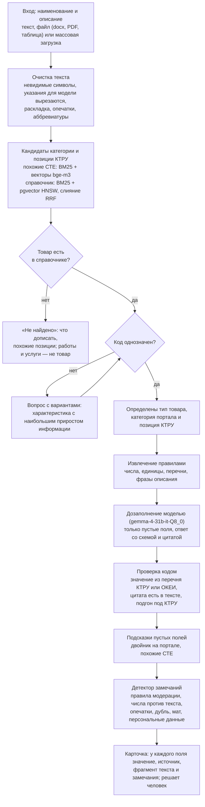
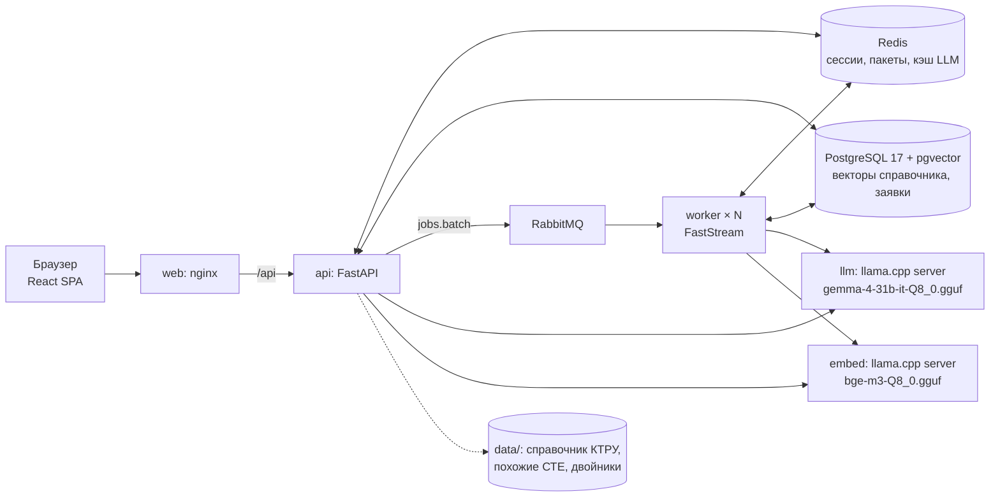
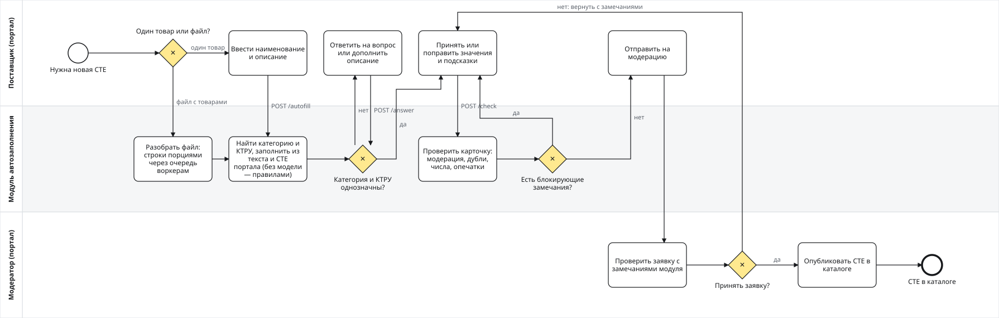

# TenderHack Казань 2026 — автозаполнение характеристик СТЕ

Кейс «Автозаполнение ключевых характеристик в СТЕ» для Портала поставщиков (zakupki.mos.ru), категории хакатона —
одежда, мебель, инструменты. Решение — модуль, который портал встраивает в форму «Создание СТЕ» через API, и
веб-интерфейс в цветах и разметке портала. По наименованию и описанию товара в свободной форме модуль:

- находит категорию портала и сужает выбор до конечного кода КТРУ (справочник — XML ЕИС организаторов, 60 087
  действующих позиций): сам, если товар однозначен, иначе вопросами с вариантами;
- заполняет характеристики из текста и приводит значения и единицы к виду КТРУ, а чего нет в КТРУ — к тому, как
  пишут на портале; свойство, которого нет нигде, не выбрасывает, а помечает «новое» — у каждого поля видно, откуда
  оно: КТРУ, портал или новое;
- предлагает значения пустых полей по такой же СТЕ портала (двойнику) и похожим СТЕ: поле остаётся пустым с
  кнопкой «Принять», в карточку идёт только принятое поставщиком; подсказка не спорит с текстом поставщика, а
  если текст её называет («латунь», «рост 176»), сразу становится значением из текста с подсветкой;
- находит ошибки с обоснованием и исправлением: значение не из перечня, единица другой величины, число против
  наименования и описания («10 А» в поле при «16 А» в тексте), число вне обычного для категории («стол высотой
  7500 мм»), опечатки в тексте и в значениях, нехватка обязательных характеристик, дубль существующей СТЕ, мат и
  персональные данные; для работ и услуг говорит, что это не товар;
- при нехватке данных говорит, что дописать, и предлагает похожие позиции.

Решение по каждому полю остаётся за человеком. Модель (LLM) спрашивают только о позиции с определённым кодом и ждут
не дольше `LLM_BUDGET_S` (15 с; при 4 с под нагрузкой обрывалась каждая четвёртая): без неё всё работает на правилах, описание укладывается в минуту.

| | |
|---|---|
| **Стенд (сайт)** | http://45.147.31.163 — мастер создания СТЕ, массовая загрузка, «Мои заявки», модерация, метрики |
| **Контракт API** | http://45.147.31.163/api/docs (Swagger), `/api/openapi.json` |
| **BPMN-схема** | [docs/bpmn/module.svg](docs/bpmn/module.svg), исходник [module.bpmn](docs/bpmn/module.bpmn) (bpmn.io, Camunda Modeler) |
| **Репозиторий** | https://github.com/ArsHighway/tander_hack_kaz_26 |
| **Модель** | локальная `gemma-4-31b-it-Q8_0.gguf` в llama.cpp server, эмбеддинги — `bge-m3-Q8_0.gguf`; облачных API нет |

## Как это работает

### Пайплайн автозаполнения



Без модели (`degraded: ["llm"]`) шаг «дозаполнение» пропускается, без эмбеддингов (`degraded: ["embeddings"]`)
поиск идёт по BM25 и похожим СТЕ. Подробнее — [дизайн модуля](docs/plans/2026-10-01-portal-module-design.md),
[математическая модель](docs/math-model.md).

### Архитектура



### BPMN процесса

[](docs/bpmn/module.svg)

Дорожки: поставщик, модуль автозаполнения, модератор портала. Файл `module.bpmn` строится из кода
(`uv run python -m scripts.bpmn` из `backend/`).

## Стек

| Слой | Что используем |
|---|---|
| Язык и окружение | Python 3.12, [uv](https://docs.astral.sh/uv/), Node 24 |
| API | FastAPI, Uvicorn, Pydantic 2 и pydantic-settings, httpx |
| Очередь и воркеры | RabbitMQ 4, FastStream (воркеры пакетной загрузки) |
| Хранилища | PostgreSQL 17 + pgvector (HNSW, косинус), Redis 7 (сессии, пакеты, кэш ответов модели), SQLAlchemy 2 (asyncio) + asyncpg, Alembic |
| Поиск | собственный BM25 со стеммером (snowballstemmer), эмбеддинги bge-m3, слияние RRF, NumPy |
| LLM | Gemma 4 31B (`gemma-4-31b-it-Q8_0.gguf`) и bge-m3 (`bge-m3-Q8_0.gguf`) в llama.cpp server, OpenAI-совместимый API; ответ со схемой JSON, проверка кодом |
| Данные | КТРУ из XML ЕИС организаторов, публичный API zakupki.mos.ru, выгрузки организаторов (openpyxl, python-calamine, py7zr, pypdf) |
| Фронтенд | React 19, TypeScript, Vite, MUI 9, Tailwind CSS 4, Emotion, Open Sans и IBM Plex Mono |
| Инфраструктура | Docker Compose, nginx, NVIDIA Container Toolkit (профиль `llm`) |
| Качество | pytest, ruff, mypy, oxlint, `node --test`, e2e на playwright-cli, GitHub Actions |


## Документы

- [docs/tz/](docs/tz/README.md) — методичка организаторов (09.10.2026), устные уточнения с открытия, критерии с
  баллами, чек-лист по критериям, разбор данных организаторов и замеры на категориях хакатона.
- [docs/plans/2026-10-01-portal-module-design.md](docs/plans/2026-10-01-portal-module-design.md) — дизайн модуля:
  контракт API, экраны, конвейер, сбои.
- [docs/demo-scenarios.md](docs/demo-scenarios.md) — сценарии показа.
- [docs/math-model.md](docs/math-model.md) — математическая модель: поиск, приведение значений, сужение, детектор, метрики.
- [docs/model-choice.md](docs/model-choice.md) — выбор LLM замером на карточках портала.
- [docs/scaling.md](docs/scaling.md) — масштабирование: пакет порциями по воркерам, несколько процессов API, лимиты
  LLM, HNSW, нагрузочные замеры.
- [docs/ktru-cleanup.md](docs/ktru-cleanup.md) — очищенный справочник КТРУ трёх тем (1 233 позиции без шаблонов,
  `data/catalog/ktru_xml.cleaned.json`): в репозиторий не входит (`data/` в `.gitignore`), собирается
  `backend/scripts/clean_ktru_catalog.py` и подключается через `KTRU_PATHS`.
- [models/README.md](models/README.md) — какие GGUF-файлы нужны сервисам `llm` и `embed` и куда их класть.
- [docs/bpmn/](docs/bpmn/) — BPMN 2.0 процесса (`module.bpmn` открывается в bpmn.io и Camunda Modeler) и картинка.
- [docs/qa/](docs/qa/) — аудит по ТЗ и проверки враждебным вводом.
  Документы в `docs/plans/` и `docs/qa/` — срезы на дату в имени файла.
- [docs/research/](docs/research/) — как TenderHack ставит задачи и оценивает, что не так на zakupki.mos.ru.

## Качество на отложенной выборке

СТЕ портала, вынутые вместе с двойниками из справочника и из похожих СТЕ: модуль видит их впервые, как новую
карточку. Без LLM — нижняя оценка. Замер 10.10.2026, повторить — `backend/scripts/eval_holdout.sh`.

| Метрика | Категории хакатона | Все категории портала |
|---|---|---|
| Случаев | 2 000 из 4 041 (одежда, мебель, инструменты) | 2 000 из 40 305 |
| Верная категория первой / среди пяти | 77,5 % / 87,7 % | 69,1 % / 83,1 % |
| Верная категория после ответа на вопрос | 83,5 % | 81,3 % |
| Категория без вопроса, из них верно | 54,5 %, 91,9 % | 45,4 %, 88,3 % |
| Уверенные ошибки (категория без вопроса, но не та) | 4,4 % | 5,3 % |
| Вопрос второго этапа (позиция КТРУ) | 10,5 % | 10,1 % |
| Значения из текста поставщика в своём поле | 51,6 % (сохранены в карточке — 64,0 %) | 41,3 % (53,3 %) |
| Характеристики, которых нет в тексте: заполнено верно / точность | 21,4 % / 74,6 % | 17,8 % / 76,3 % |
| Точность значений по источнику: правила / двойник / похожие СТЕ | 65,7 % / 94,9 % / 77,6 % | 63,8 % / 94,2 % / 79,9 % |
| Характеристик вручную на СТЕ (ввести или исправить) | 3,8 из 8,6 | 3,6 из 7,5 |
| Без единого действия (код без вопроса, обязательные заполнены) | 35,7 % | 27,6 % |
| Обязательные характеристики заполнены модулем | 62,9 % | 57,6 % |
| Ответ шага: медиана / 95-й перцентиль / дольше 7 с | 265 мс / 485 мс / 0 % | 593 мс / 1,1 с / 0 % |

Категории хакатона мерились без векторного поиска по справочнику, все категории — с ним, как на стенде (отсюда и
разница в задержке: запрос эмбеддинга). Те же метрики — на странице «Метрики» стенда
(`GET /api/v1/metrics/holdout`). Решения подбирались на этих 2 000 случаях; на остальных 2 041 случае категорий
хакатона, которых модуль не видел (`--skip 2000`), — не хуже: категория первой / среди пяти 78,1 % / 88,5 %, без
вопроса верно 93,2 %, уверенные ошибки 3,6 %.

Проверки карточки — на честных карточках портала (44 тыс. карточек отложенной выборки, ложная тревога — то, что
увидит поставщик с верными данными): число поля против текста — замечание у 0,52 % карточек (230 из 44 346; до
сверки с размерами «1900х800 мм» было 0,32 %), и это чаще настоящие ошибки портала («Количество листов: 160» при
«80 листов», «Ширина: 0» при «43х33х23 см»); число вне обычного для категории — у 1,4 % значений, в основном
ошибки единиц; опечатки — 105 замечаний на 44 тыс. карточек, почти все настоящие. Подсказки похожих СТЕ и
двойника — предложение: в карточку идёт только принятое поставщиком. Подсказку, которую текст опровергает, не
ставим (0,7 % подсказок на 2 000 случаях), а которую текст называет — отдаём значением из текста: число —
только равное подсказке, слово — не после «не/без» и не под подписью другого поля. Такие значения верны в
93,7 % (111 сверенных), подсказки похожих СТЕ — в 77,3 %, двойника — в 94,7 %; вместе верных столько же, сколько
до разделения (83,1 %).

Золотой набор (`app.tools.evaluate`, синтетика с известным ответом — проверка логики, а не качество на живых
данных): конечный код 100 % на 90 описаниях шаблона и 139 описаниях реальных форматов; отказ на товарах вне
справочника 100 %; из 100 почти одинаковых товаров, различающихся только толщиной, верная позиция по тексту — 300
из 300 («0,075 мм», «75 мкм», «0.075мм»), без толщины — вопрос о ней.

## Запуск

Нужны Docker с Compose v2. Для модели — NVIDIA GPU и NVIDIA Container Toolkit (или Docker Desktop с WSL2).

```bash
git clone https://github.com/ArsHighway/tander_hack_kaz_26.git && cd tander_hack_kaz_26
cp .env.example .env          # модель, справочник, порты (архив стенда команды кладёт свой .env — см. «Данные стенда»)

# 1. Без модели: правила, справочник, поиск (ответы помечаются degraded: ["llm"], ["embeddings"])
docker compose up -d --build

# 2. С моделью: положить gemma-4-31b-it-Q8_0.gguf и bge-m3-Q8_0.gguf в models/ (models/README.md)
docker compose --profile llm up -d --build

docker compose exec api python -m app.tools.evaluate   # метрики на золотом наборе для страницы «Метрики»
```

| Что | Адрес |
|---|---|
| Образец экранов портала: создание СТЕ, массовая загрузка, заявки, модерация, метрики, API | http://localhost:8080 |
| Контракт API (Swagger, OpenAPI) | http://localhost:8080/api/docs, `/api/openapi.json` |
| Готовность зависимостей | http://localhost:8080/api/health/ready |
| RabbitMQ UI (tenderhack / tenderhack) | http://localhost:15672 |
| Чат-модель (llama.cpp server, профиль `llm`) | http://127.0.0.1:8081/v1 |
| Эмбеддинги (llama.cpp server, профиль `llm`) | http://127.0.0.1:8082/v1 |

Модель — локальная `gemma-4-31b-it-Q8_0.gguf` в llama.cpp server, сервис `llm` в `docker-compose.yml` (файл
`LLM_MODEL_FILE` из `models/`, имя в API `LLM_CHAT_MODEL=gemma-4-31b-it-Q8_0`, второй слой проверки —
та же модель, `LLM_REVIEW_MODEL`). Облачные API и Ollama не используются, данные организаторов с машины не уходят.
Тот же код работает с любым сервером с OpenAI-совместимым API (`LLM_BASE_URL`). Эмбеддинги — отдельный экземпляр
сервера с `bge-m3-Q8_0.gguf` (`EMBED_*`, сервис `embed`); без них поиск идёт по BM25 и похожим СТЕ, а ответ
помечается `degraded: ["embeddings"]`. Без LLM характеристики извлекаются правилами (`degraded: ["llm"]`).
Процессов API — `API_WORKERS`, реплик воркера — `WORKER_REPLICAS` ([docs/scaling.md](docs/scaling.md)).
Выбор и оговорки по модели — [docs/model-choice.md](docs/model-choice.md). Проверка модели и сервера после
запуска — `cd backend && uv run python -m app.tools.llm_smoke`.

## Данные стенда

Справочник подключается переменными `.env`, контракт API от него не зависит. Данные портала и организаторов в git
не идут (`data/` в `.gitignore`).

- **Чистый клон без данных** — демо-справочник (`backend/app/catalog/demo/demo.json`, синтетика с именами
  характеристик портала): конвейер и экраны работают сразу, но позиций в нём 17 — это не то, что показываем на
  защите.
- **Стенд команды** — 8 569 категорий «Товаров» портала, 3,7 млн СТЕ, КТРУ из XML ЕИС организаторов. Всё
  предобработанное — один архив `tenderhack-kazan-stand-20261010.zip` (2,2 ГБ, SHA-256 в `.sha256.txt` рядом) в
  папке команды на Google Диске. Он распаковывается **в корень клона**: кладёт готовый `.env` (пути к данным
  прописаны, `LLM_API_KEY` пустой) и `data/catalog/`, `data/metrics/`, `data/cache/images/`. Собран под коммит
  `40ddbaa`; проверен на чистом клоне 10.10 — пакет из 200 строк мебели организаторов: 191 `ready`, 10 `needs_fix`,
  0 «нет в справочнике».

  ```bash
  git clone https://github.com/ArsHighway/tander_hack_kaz_26.git && cd tander_hack_kaz_26
  unzip ../tenderhack-kazan-stand-20261010.zip      # Windows: Expand-Archive <путь к zip> -DestinationPath .
  # .env из архива написан под Ollama (LLM_PROVIDER=ollama код не принимает): блок LLM_* и EMBED_*
  # заменить блоком из .env.example и положить .gguf в models/
  docker compose --profile llm up -d --build

  # один раз после первого запуска — векторы справочника в pgvector (ответ: COPY 8569)
  docker compose cp data/catalog/catalog_embedding.csv postgres:/tmp/emb.csv
  docker compose cp data/catalog/load_embedding.sql postgres:/tmp/load.sql
  docker compose exec postgres psql -U tenderhack -d tenderhack -f /tmp/load.sql
  ```

- **Тип товара по КТРУ (с 10.10, вечер)** — дополнение `tenderhack-kazan-ktru-types-20261010.zip` (4 МБ) в той
  же папке, поверх архива стенда. Справочник типов КТРУ (`data/catalog/ktru_types.json`: 260 типов КТРУ
  одежды, мебели и инструментов и 392 категории хакатона без типа) и его векторы. Подключение — в
  `README-ktru-types.txt` внутри: распаковать в корень клона, `CATALOG_PATHS=data/catalog/ktru_types.json`,
  загрузить векторы (ответ `COPY 652`). Сборка из сырья — `build_ktru_catalog --scope hack` и
  `build_ktru_types --fallback`.

  Векторы работают при запущенном сервисе `embed` (`bge-m3-Q8_0.gguf` в `models/`, профиль `llm`); без него поиск
  идёт по BM25 и похожим СТЕ. Посчитать векторы заново — `docker compose exec api python -m
  app.tools.index_catalog` (~5 мин). Проверка: в мастере «Стол приставной КЭ10 бук» → `01.16.03.10 Столы
  приставные`; полный прогон — `cd frontend && npm run e2e`. Нужно ~12 ГБ на диске и ~8 ГБ памяти Docker (API и два
  воркера по ~2,5 ГБ; меньше — `WORKER_REPLICAS=1`).

  **«Категория не найдена в справочнике» почти на всё** (в пакете — сплошь «нет в справочнике») — стенд работает на
  демо-справочнике: пустые пути в `.env` или нет файлов в `data/catalog/`. Исправить и `docker compose up -d api
  worker`.

  Исходники для пересборки (сырые выгрузки портала и ЕИС, отложенные выборки) — `tenderhack-kazan-full.zip` (3,4 ГБ,
  09.10) в той же папке, распаковывается в `data/`.
- **Собрать самим** из публичного API портала и XML КТРУ организаторов — `backend/scripts/build_stand_data.sh`
  (выгрузка с портала — часы, `FETCH=1`; сборка — около часа, ~4,5 ГБ памяти).
- **Таблица СТЕ организаторов** (формат пермской выгрузки: категория именем, характеристики строкой
  «имя:значение;…») — одной командой `uv run python -m app.tools.catalog_from_table <файл>` (из `backend/`):
  справочник и похожие СТЕ, затем те же переменные.

## API модуля

| Метод | Что делает |
|---|---|
| `POST /api/v1/autofill` | наименование и описание → категория и кандидаты КТРУ, характеристики с фрагментом текста и источником, свойства вне шаблона, замечания, вопрос |
| `POST /api/v1/autofill/{session_id}/answer` | ответ на уточняющий вопрос → сужение до кода или шаги |
| `POST /api/v1/check` | готовая карточка → замечания с обоснованием, исправлением и ссылкой на правило модерации |
| `GET /api/v1/ktru/{code}` | категория справочника или позиция КТРУ: название, путь, характеристики |
| `POST /api/v1/batch`, `GET /api/v1/batch/{id}`, `…/result.xlsx` | массовая загрузка через очередь |
| `POST /api/v1/extract` | текст из файла (docx, PDF, таблица) для шага «Описание» |
| `GET /api/v1/metrics`, `…/metrics/holdout`, `…/metrics/portal` | качество: золотой набор, отложенная выборка СТЕ, живые карточки портала |
| `GET /api/v1/images/sku/{id}`, `…/images/category/{id}` | миниатюры похожих СТЕ и картинки категорий (кэш на диске) |

Стенд портала для показа (не часть модуля): очередь заявок модератора `/api/demo/submissions` — у каждой
`triage`: чистая (без блокирующих замечаний и предупреждений модуля, в том числе по позиции КТРУ — они первые в
причинах) или почему её открыть, принятые поставщиком подсказки только считаются (`hinted`);
`POST /api/demo/submissions/accept-clean` с `ids` из списка, который модератор подтвердил в диалоге, одобряет те из
них, что всё ещё чистые, с записью в журнале заявки.

## Инструменты

```bash
cd backend
bash scripts/build_stand_data.sh                                # данные стенда из сырья (FETCH=1 — с выгрузкой портала)
bash scripts/eval_holdout.sh                                    # честный замер: справочник без выборки, два прогона
uv run python -m app.tools.recon <что дали организаторы>        # формат, колонки, роли, характеристики
uv run python -m app.tools.mine_abbreviations <данные> --to-db  # аббревиатуры из их базы в таблицу
uv run python -m app.tools.evaluate [--llm]                     # золотой набор, метрики, калибровка порога
uv run python -m app.tools.hackathon_holdout                    # выборка категорий хакатона по листу 2 примеров выгрузок
uv run python -m app.tools.plausible_ranges <справочник> --exemplars <похожие>  # пределы чисел по СТЕ категории
uv run python -m app.tools.find_synonyms llm|embed|check|judge|apply  # синонимы характеристик по смыслу (один раз)
uv run python -m app.tools.fix_units <справочник.json>          # единицы собранного справочника по нынешнему словарю
uv run python -m app.tools.load_test check|autofill|batch …     # нагрузочный прогон, цифры — docs/scaling.md
uv run python -m app.tools.export_openapi                       # контракт для фронта, затем npm run gen:api
uv run python -m scripts.bpmn                                   # BPMN и SVG из кода
uv run python scripts/make_fake_dataset.py                      # фейковый датасет для тестов
```

## Разработка

Бэкенд (Python 3.12, uv):

```bash
docker compose up -d postgres redis rabbitmq migrate   # инфраструктура
cd backend
uv sync
uv run uvicorn app.main:app --reload     # API на :8000 (без CATALOG_PATHS — демо-справочник)
uv run faststream run app.worker:app     # воркер очереди
uv run pytest
uv run ruff check . && uv run ruff format .
```

Фронтенд (React 19 + Vite + TypeScript, MUI, Tailwind 4 для раскладки):

```bash
cd frontend
npm ci
npm run dev      # http://localhost:5173, /api проксируется на :8000 (VITE_API_PROXY)
npm test && npm run build && npm run lint
npm run e2e      # сквозные сценарии на :8080 (playwright-cli); обязательны перед показом — docs/demo-scenarios.md
```

## Структура

```
backend/app/catalog     справочник позиций: модель, загрузчики JSON/CSV, КТРУ из XML ЕИС, каталог в памяти
backend/app/values.py   значение против перечня: корзины, диапазоны, единицы, опечатки
backend/app/checks      правила модерации портала, детектор ошибок карточки, опечатки, мат, персональные данные
backend/app/search      кандидаты: похожие СТЕ (BM25 и векторы), BM25 справочника, эмбеддинги (pgvector), RRF;
                        двойники, подсказки полей, подсказка против текста
backend/app/extract     извлечение характеристик: правила, свойства вне шаблона, затем LLM с проверкой ответа кодом
backend/app/narrowing.py сужение до кода и уточняющие вопросы; app/session.py — сессия в Redis
backend/app/pipeline.py конвейер /autofill, /answer, /check (модель — по определённой позиции, LLM_BUDGET_S);
                        app/batch.py — массовая загрузка; app/demo — заявки стенда
backend/app/evaluation  золотой набор и метрики; app/portal/holdout.py — отложенная выборка СТЕ
backend/app/ingest      чтение файлов, разбор характеристик, словарь единиц (ОКЕИ, мВт/МВт, ° и °C)
backend/scripts         сборка данных стенда, честный замер, BPMN
frontend/src/pages      экраны: create, batch, mine, moderation, metrics, developers
docs/                   ТЗ, дизайн, BPMN, замеры, ресерч
models/                 GGUF-файлы чат-модели и эмбеддингов (в git не идут), models/README.md
```

## Правила, которые влияют на код

- Данные организаторов не коммитим: `data/` в `.gitignore`.
- Значение и единица попадают в ответ, только если они есть в справочнике позиции и в ОКЕИ; это проверяет код.
  Значение остаётся в единице позиции (КТРУ «Длина, мм»); короткая запись («1500 мм» = «1,5 м») — подсказка рядом.
- Ответ модели проверяет код: цитата есть в тексте и содержит значение, значение есть в перечне.
- Модель — только локальная (`gemma-4-31b-it-Q8_0.gguf`); внешних облачных API в коде нет.
- Секреты — только в `.env`.
